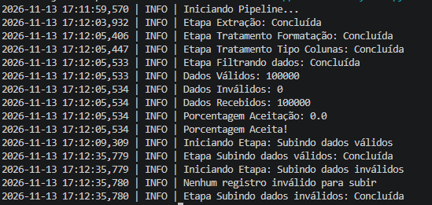

# Pipeline ETL de Compras Públicas

Pipeline de dados em Python que lê um CSV de compras públicas (100 mil registros), trata e valida os dados com Pandas e carrega o resultado em um banco PostgreSQL, separando registros **válidos** e **inválidos** em tabelas distintas.

O projeto foi construído para praticar os fundamentos de Engenharia de Dados: organização em etapas, validação, logging, métricas de qualidade e gerenciamento seguro de credenciais.

## Execução do pipeline



## Arquitetura

```
compras_publicas.csv
        │
        ▼
  extracao.py      seleciona as colunas e gera o CSV intermediário
        │
        ▼
  transform.py     padroniza, converte tipos, valida e separa válidos/inválidos
        │
        ├──► dados_tratados.csv
        └──► dados_invalidos.csv
                │
                ▼
  load.py          carrega as duas saídas no PostgreSQL
        │
        ├──► tabela de registros válidos
        └──► tabela de registros inválidos
```

A orquestração é feita pelo `main.py`, que executa as etapas na ordem.

## Etapas

### 1. Extração (`extracao.py`)
- Lê o CSV de origem com todas as colunas como texto (`dtype=str`), evitando que o Pandas infira tipos errados.
- Seleciona as 9 colunas usadas no projeto e salva o resultado em `dados_reformulados_silver.csv`.

### 2. Transformação (`transform.py`)
- **Formatação:** `nome_municipio`, `nome_orgao` e `sigla_uf` em maiúsculas; `orcamento_sigiloso` e `objeto_compra` em minúsculas; remoção de espaços nas pontas.
- **Tipos:** conversão de `ano_compra_pncp` para numérico.
- **Validação:** um registro é considerado inválido se qualquer um destes campos estiver nulo: `id_compra`, `sigla_uf`, `nome_municipio`, `ano_compra_pncp`, `nome_orgao`, `objeto_compra`.
- **Regra de negócio:** `data_encerramento_proposta` pode ser vazia, pois a proposta ainda pode estar em andamento. Por isso esse campo não invalida o registro.
- **Métricas:** registra no log o total de registros recebidos, válidos e inválidos e o percentual de inválidos, com alerta quando passa de 10%.

### 3. Carga (`load.py`)
- Conexão com o PostgreSQL via SQLAlchemy + psycopg2, com credenciais lidas de variáveis de ambiente (`.env`).
- Inserção dentro de transação (`engine.begin()`): se der erro, nada é gravado pela metade.
- Proteção para listas vazias: se não houver registros inválidos, a etapa é ignorada e registrada no log.
- Cada etapa roda dentro de uma função de controle (`definindo_etapas`) que registra início, conclusão e erro (com traceback), e relança a exceção.

## Logging

A configuração fica centralizada em `config_logging.py`. O formato inclui data e hora, nível e mensagem:

```
2026-11-13 17:12:09,309 | INFO | Iniciando Etapa: Subindo dados válidos
2026-11-13 17:12:35,779 | INFO | Etapa Subindo dados válidos: Concluída
```

## Tecnologias

- Python
- Pandas
- SQLAlchemy
- psycopg2
- python-dotenv
- PostgreSQL

## Como executar

**1. Clone o repositório e instale as dependências**

```bash
git clone https://github.com/PedroIAM/ETL-Compras-publicas.git
cd <nome-do-repositorio>
pip install -r requirements.txt
```

**2. Configure as variáveis de ambiente**

Copie o arquivo `.env.example` para `.env` e preencha com os seus dados:

```bash
cp .env.example .env
```

| Variável | Descrição |
|---|---|
| `usuario` | usuário do PostgreSQL |
| `senha` | senha do PostgreSQL |
| `host` | host do banco |
| `port` | porta do banco |
| `data_base` | nome do banco de dados |
| `data_valid` | nome da tabela de registros válidos |
| `data_invalid` | nome da tabela de registros inválidos |

**3. Crie as tabelas**

Crie as duas tabelas no PostgreSQL com as 9 colunas do projeto: `id_compra`, `sigla_uf`, `nome_municipio`, `ano_compra_pncp`, `nome_orgao`, `orcamento_sigiloso`, `objeto_compra`, `valor_total_estimado` e `data_encerramento_proposta`.

Observações sobre os dados reais:
- `valor_total_estimado` chega a valores na casa de bilhões, então use uma precisão larga (por exemplo, `NUMERIC(18,2)`).
- `objeto_compra` tem descrições longas (passam de 1.400 caracteres), então use `TEXT`.
- `data_encerramento_proposta` é armazenada como texto.

**4. Adicione o CSV de origem**

Coloque o arquivo `compras_publicas.csv` na raiz do projeto. Os dados são de compras públicas e foram obtidos na [Base dos Dados](https://basedosdados.org/).

**5. Execute**

```bash
python main.py
```

## Estrutura do projeto

```
.
├── main.py              # executa o pipeline na ordem
├── extracao.py          # etapa de extração
├── transform.py         # tratamento, validação e separação
├── load.py              # carga no PostgreSQL
├── config_logging.py    # configuração central do logging
├── requirements.txt
├── .env.example
└── docs/
    └── terminal_pipeline.png
```

## Limitações conhecidas e próximos passos

Este projeto está em evolução. Os pontos que pretendo melhorar:

- [ ] **Idempotência:** hoje, rodar o pipeline duas vezes duplica os registros, porque `id_compra` pode se repetir e não há chave primária. Pretendo adotar recarga completa (`DELETE` + `INSERT` na mesma transação).
- [ ] **Tratamento de nulos na carga:** converter valores vazios para `NULL` antes de enviar ao banco.
- [ ] **Estrutura em funções:** transformar cada etapa em função (`extrair()`, `transformar()`, `carregar()`) e deixar o `main.py` apenas orquestrando.
- [ ] **Validações adicionais:** valores negativos, ano plausível e `sigla_uf` com 2 caracteres.
- [ ] **Performance:** testar carga em lotes (chunks) e medir a diferença.
- [ ] **Testes automatizados** das regras de validação.
- [ ] **Evolução da stack:** Docker e orquestração com Apache Airflow.

## Autor

Desenvolvido por Pedro, estudante de Ciência da Computação, em formação para atuar como Engenheiro de Dados.

GitHub: [@PedroIAM](https://github.com/PedroIAM)